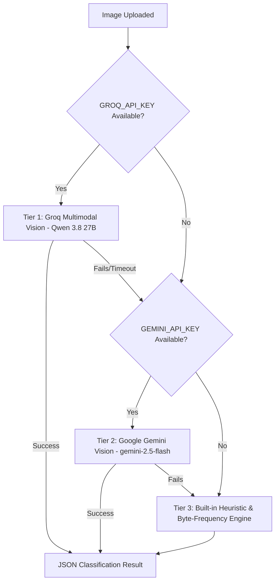
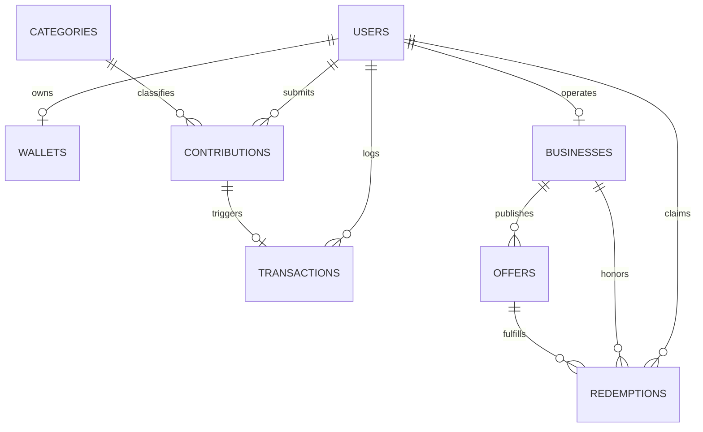

# 🌱 Green Rewards – Smart Waste Segregation & Citizen Incentive Platform

> **Academic Project** &bull; **B.Tech Semester 3** &bull; **React.js & Next.js Full-Stack Web Development**  
> An automated, closed-loop sustainability platform combining **Multimodal AI Vision**, **Role-Based Access Control (RBAC)**, an **Immutable Financial Transaction Ledger**, and **Merchant Discount Redemptions**.

[](https://nextjs.org/)
[](https://react.dev/)
[](https://tailwindcss.com/)
[](https://zod.dev/)
[](https://nodejs.org/)
[](#)

---

## 📑 Table of Contents
1. [Executive Summary & Motivation](#-executive-summary--motivation)
2. [System Architecture & Workflow Diagrams](#-system-architecture--workflow-diagrams)
3. [Key Highlights & Unique Innovations](#-key-highlights--unique-innovations)
4. [Exhaustive Project Directory Structure](#-exhaustive-project-directory-structure)
5. [User Roles & Feature Breakdown](#-user-roles--feature-breakdown)
6. [Multimodal AI Waste Vision Engine](#-multimodal-ai-waste-vision-engine)
7. [Two-Tier Route Protection & Security (RBAC)](#-two-tier-route-protection--security-rbac)
8. [Database Engine & Relational Schema](#-database-engine--relational-schema)
9. [Complete REST API Reference](#-complete-rest-api-reference)
10. [Technology Stack & Dependencies](#-technology-stack--dependencies)
11. [Quickstart & Viva Demo Credentials](#-quickstart--viva-demo-credentials)
12. [Academic Syllabus Mapping (B.Tech Sem 3)](#-academic-syllabus-mapping-btech-sem-3)
13. [Top 10 Viva / Interview Questions & Answers](#-top-10-viva--interview-questions--answers)

---

## 📖 Executive Summary & Motivation

### The Problem
Municipal solid waste management faces a critical bottleneck worldwide: **low rates of segregation at the source**. When organic kitchen waste (wet), clean recyclables (dry), and toxic electronics (e-waste) are mixed in domestic bins, compost streams are contaminated, recyclables are degraded, and toxic heavy metals leach into landfills. Traditional awareness campaigns lack measurable incentives, leading to citizen apathy and municipal overload.

### The Green Rewards Solution
**Green Rewards** converts domestic environmental diligence into tangible daily savings through a closed-loop digital ecosystem:
1. **Citizen:** Segregates household waste into 4 standardized municipal streams (**Wet Waste**, **Dry Waste**, **E-Waste**, **Other Waste**), takes a photograph, and submits it through the portal.
2. **AI Pre-Screening & Auto-Approval:** An intelligent vision cascade (Groq Qwen 3.8 27B / Google Gemini Vision / Built-in Heuristic Engine) inspects the photograph. If the waste category matches municipal segregation criteria, the submission is **automatically approved immediately**, and digital **Green Coins** are minted to the citizen's wallet.
3. **Admin Oversight:** Submissions with category discrepancies or ambiguous visual profiles are flagged for manual municipal administrator review.
4. **Local Business Redemptions:** Local partner merchants (grocery stores, bakeries, clothing shops) publish discount offers. Citizens redeem their Green Coins for single-use voucher tokens to receive instant cash discounts at checkout. Merchants verify and honor vouchers on their portal.

---

## 🏛️ System Architecture & Workflow Diagrams

### 1. High-Level Closed-Loop Workflow
```
 ┌────────────────┐         Uploads Photo          ┌─────────────────────────┐
 │                │ ─────────────────────────────> │  GreenRewards Platform  │
 │    CITIZEN     │                                └────────────┬────────────┘
 │                │ <─────────────────────────────              │
 └───────┬────────┘    Instant Green Coins Credit               │
         │                                                      │
         │ Presents Voucher Token                               │ Categorization &
         │ at Store Checkout                                    │ Auto-Approval Check
         ▼                                                      ▼
 ┌────────────────┐                                ┌─────────────────────────┐
 │ PARTNER STORE  │ ── Verifies & Honors Voucher ─ │ Multimodal AI Cascade   │
 │   (Business)   │ <─ (Deducts Token / Ledger) ── │ & Admin Review Queue    │
 └────────────────┘                                └─────────────────────────┘
```

### 2. Automated AI Verification & Instant Reward Pipeline
```
[ Citizen Uploads Waste Image ]
             │
             ▼
[ POST /api/waste/upload ] ──> Validates MIME (JPEG, PNG, WebP) & Size (<= 5MB)
             │
             ▼
[ AI Vision Engine (lib/ai.js) ]
    ├── Tier 1: Groq Vision (Qwen 3.8 27B) [Latency: ~400ms]
    ├── Tier 2: Google Gemini Vision Fallback (gemini-2.5-flash)
    └── Tier 3: Built-in Heuristic & Byte-Frequency Engine (100% Offline)
             │
             ▼
[ Category Match Evaluation ]
    ├── Category Matched? (e.g. AI "wet" === Selected "wet")
    │       │
    │       ├── YES ──> [ AUTO-APPROVED ]
    │       │             ├── Status = 'Approved'
    │       │             ├── Wallet.balance += Reward Coins (Atomic)
    │       │             ├── Ledger: CREDIT_REWARD Transaction Logged
    │       │             └── Live Navbar Counter Updates via useWallet()
    │       │
    │       └── NO  ──> [ QUEUED FOR ADMIN REVIEW ]
    │                     ├── Status = 'Pending'
    │                     ├── Flagged with AI Recommendation Warning
    │                     └── Admin Review Queue (/admin/submissions)
```

---

## ✨ Key Highlights & Unique Innovations

* **Zero External DB Dependency:** Uses an embedded, atomic, file-based relational JSON database with a complete Repository Pattern abstraction in `lib/db.js`.
* **Zero External AI Key Requirement:** Includes a 3-tier cascade featuring a built-in offline heuristic classifier so the app functions 100% offline without any API keys during college presentations.
* **Vercel Serverless Ready:** Dynamically detects serverless lambda environments and falls back to `/tmp/db.json` with base64 Data URLs, bypassing serverless read-only filesystem restrictions without requiring paid cloud storage (S3/Cloudinary).
* **Two-Tier RBAC:** Combines client-side React redirection guards (`ProtectedRoute.js`) with server-side bearer token validation on all 17 Route Handlers.
* **Strict Double-Reward & Double-Refund Guards:** Prevents re-approving submissions or re-refunding rejected merchant vouchers.

---

## 📂 Exhaustive Project Directory Structure

```
Waste_Mgmt/
├── app/                                 # Next.js App Router (Pages, Layouts & APIs)
│   ├── about/
│   │   └── page.js                      # Academic syllabus, problem statement & project info
│   ├── admin/                           # Administrator Portal (Role: ADMIN)
│   │   ├── businesses/page.js           # Directory of participating partner stores
│   │   ├── categories/page.js           # Category reward coin modifier & guideline manager
│   │   ├── citizens/page.js             # Registered citizens directory & submission stats
│   │   ├── dashboard/page.js            # Municipal admin metrics & pending review queue
│   │   ├── submissions/page.js          # Photo review tool (Approve/Reject with feedback)
│   │   └── transactions/page.js         # Platform-wide immutable audit transaction ledger
│   ├── api/                             # Backend REST Route Handlers (JSON Endpoints)
│   │   ├── admin/
│   │   │   ├── businesses/route.js      # GET: List partner businesses & metrics
│   │   │   ├── citizens/route.js        # GET: List citizens with balances & stats
│   │   │   ├── stats/route.js           # GET: Aggregated municipal platform statistics
│   │   │   ├── submissions/
│   │   │   │   ├── [id]/route.js        # PUT: Admin review (Approve / Reject submission)
│   │   │   │   └── route.js             # GET: Filtered submissions list with relational joins
│   │   │   └── transactions/route.js    # GET: Full platform financial audit trail
│   │   ├── auth/
│   │   │   ├── login/route.js           # POST: Authenticate user & issue session token
│   │   │   └── register/route.js        # POST: Register Citizen or Business with Zod validation
│   │   ├── business/
│   │   │   ├── dashboard/route.js       # GET: Store metrics, active offers, voucher count
│   │   │   ├── offers/route.js          # GET / POST: Create & manage merchant discount offers
│   │   │   └── redemptions/route.js     # GET / PUT: Verify & honor/reject customer vouchers
│   │   ├── categories/
│   │   │   └── route.js                 # GET / PUT: Public categories list & Admin reward updater
│   │   ├── citizen/
│   │   │   ├── contributions/route.js   # GET: Citizen submission history filtered by citizenId
│   │   │   ├── offers/route.js          # GET / POST: Browse store offers & claim redemption
│   │   │   ├── redemptions/route.js     # GET: Citizen claimed voucher tokens & live statuses
│   │   │   └── wallet/route.js          # GET: Live wallet balance & citizen transaction log
│   │   └── waste/
│   │       ├── detect/route.js          # POST: Real-time AI classification endpoint
│   │       └── upload/route.js          # POST: Multipart upload, AI verify, and auto-approval
│   ├── business/                        # Local Business Portal (Role: BUSINESS)
│   │   ├── dashboard/page.js            # Store metrics, pending customer requests
│   │   ├── offers/page.js               # Create & manage discount vouchers
│   │   ├── profile/page.js              # Merchant store profile & address
│   │   └── redemptions/page.js          # Customer checkout voucher verification queue
│   ├── businesses/
│   │   └── page.js                      # Public directory of partner stores & active offers
│   ├── categories/
│   │   └── page.js                      # Public segregation guidelines (Do's & Don'ts)
│   ├── citizen/                         # Citizen Portal (Role: CITIZEN)
│   │   ├── contributions/page.js        # Submission history table with photos & status badges
│   │   ├── dashboard/page.js            # Personal metric cards, quick actions, recent activity
│   │   ├── profile/page.js              # Citizen account details & total earnings summary
│   │   ├── redemptions/page.js          # Claimed vouchers with tokens for store checkout
│   │   ├── rewards/page.js              # Offer catalog to exchange Green Coins for discounts
│   │   ├── upload/page.js               # Photo upload with live preview & instant AI auto-approval
│   │   └── wallet/page.js               # Green Coin balance hero & immutable personal ledger
│   ├── how-it-works/
│   │   └── page.js                      # 5-step interactive workflow guide
│   ├── login/
│   │   └── page.js                      # Authentication page with one-click viva demo credentials
│   ├── register/
│   │   └── page.js                      # Registration page with dynamic Citizen/Business role selector
│   ├── globals.css                      # Tailwind CSS v4 directives & font imports
│   ├── layout.js                        # Root Layout with persistent Navbar, Footer, and Providers
│   └── page.js                          # Public Landing Homepage with dynamic auth redirection
├── components/                          # Reusable UI & Layout Components
│   ├── ui/
│   │   ├── Badge.js                     # Status badges (success, warning, danger, coin, info)
│   │   ├── Button.js                    # Reusable button with variants (primary, secondary, outline, accent)
│   │   └── Card.js                      # Reusable container card with optional hover lift
│   ├── Footer.js                        # Semantic HTML5 footer with dynamic auth links
│   ├── Navbar.js                        # Sticky navigation with live coin counter & mobile drawer
│   ├── PortalSidebar.js                 # Role-isolated navigation sidebar (Citizen/Admin/Business)
│   ├── ProtectedRoute.js                # Client-side RBAC guard with loading spinner & redirects
│   ├── Providers.js                     # Root Context Provider wrapper (AuthProvider, WalletProvider)
│   └── StatCard.js                      # Reusable metric card with icons & color themes
├── context/                             # React Context API Global State
│   ├── AuthContext.js                   # Authentication state, login/register/logout handlers
│   └── WalletContext.js                 # Reactive Green Coin balance & ledger synchronization
├── data/
│   └── db.json                          # Persistent relational JSON database file
├── hooks/                               # Custom React Hooks
│   ├── useAuth.js                       # Convenience hook wrapper for AuthContext
│   └── useWallet.js                     # Convenience hook wrapper for WalletContext
├── lib/                                 # Server & Core Utility Modules
│   ├── ai.js                            # Multimodal AI Vision engine (Groq, Gemini, Local Fallback)
│   ├── auth.js                          # SHA-256 password hashing with salt & base64 session tokens
│   ├── constants.js                     # Categories, roles, statuses, and transaction types
│   ├── db.js                            # Relational database CRUD service & atomic disk persistence
│   └── validations.js                   # Zod validation schemas for forms and API payloads
├── public/                              # Static Public Assets
│   └── uploads/                         # Local storage directory for uploaded waste photos
├── package.json                         # Node dependencies & project scripts
└── README.md                            # Comprehensive project documentation
```

---

## 👥 User Roles & Feature Breakdown

### 1. Citizen Portal (`Role: CITIZEN`)
* **Dashboard (`/citizen/dashboard`):** Real-time metric cards (Available Green Coins, Total Submissions, Approved Count, Pending Count), recent contribution activity, and quick-action shortcuts.
* **Waste Upload with AI (`/citizen/upload`):** File input with drag-and-drop support, client-side photo preview, instant AI auto-detection, auto-selected category, quantity input, and **Instant Auto-Approval banner**.
* **Contribution History (`/citizen/contributions`):** Responsive data table with waste thumbnail photos, category badges, submitted quantities, timestamps, reward amounts, and admin/AI feedback.
* **Green Coin Wallet (`/citizen/wallet`):** Balance hero card showing estimated fiat discount equivalence (approx. ₹0.25–₹0.30 per coin) and an immutable transaction ledger.
* **Redeem Offers (`/citizen/rewards`):** Catalog of partner store discount vouchers. Validates coin balance client-side and server-side before creating a voucher.
* **Claimed Redemptions (`/citizen/redemptions`):** Displays unique alphanumeric voucher tokens (`rdm_...`) to present at merchant store checkouts.
* **Profile (`/citizen/profile`):** Account credential overview, user ID, role badge, and total accumulated Green Coins.

### 2. Administrator Portal (`Role: ADMIN`)
* **Dashboard (`/admin/dashboard`):** Aggregated municipal metrics (Total Citizens, Pending Reviews, Approved Count, Total Green Coins Minted) and pending queue summary.
* **Submission Review Center (`/admin/submissions`):** Filter by `Pending`, `Approved`, `Rejected`, or `All`. Displays high-resolution waste photograph, citizen identity, quantity, and AI pre-screen breakdown.
  * **Approve Action:** Atomically credits reward coins to citizen wallet and logs transaction.
  * **Reject Action:** Prompts for mandatory explanatory feedback for citizen correction.
* **Waste Categories Manager (`/admin/categories`):** Live modification of reward coin rates per category (Wet, Dry, E-Waste, Other). Updates immediately affect all future submissions.
* **Citizen Directory (`/admin/citizens`):** Searchable table of registered citizens, participation frequency, approval rates, and current wallet balances.
* **Partner Businesses Directory (`/admin/businesses`):** Listing of registered local stores, active offer counts, vouchers honored, and total coins accepted.
* **Platform Audit Ledger (`/admin/transactions`):** Complete immutable financial ledger auditing every Green Coin created or redeemed across the entire municipal ecosystem.

### 3. Local Business Portal (`Role: BUSINESS`)
* **Dashboard (`/business/dashboard`):** Store metrics (Active Offers, Pending Customer Requests, Accepted Vouchers, Total Coins Accepted from Citizens).
* **Manage Offers (`/business/offers`):** Create and publish discount vouchers with custom titles, descriptions, required coins, and discount values (e.g. ₹25 OFF).
* **Verify Redemptions (`/business/redemptions`):** Customer checkout verification queue:
  * **Accept & Honor:** Marks voucher as `Accepted`, honoring the store discount.
  * **Reject:** Marks voucher as `Rejected` and **automatically refunds the Green Coins** back into the citizen's wallet.
* **Store Profile (`/business/profile`):** Business identity, store location/ward, and owner credentials.

---

## 🤖 Multimodal AI Waste Vision Engine

The AI subsystem in [`lib/ai.js`](file:///Users/shahpershahin/Downloads/Study/B.Tech/SEM 3/Waste_Mgmt/lib/ai.js) implements a **3-tier resilient cascade**:



### Standard Output Format:
```json
{
  "category": "wet",
  "categoryName": "Wet Waste",
  "confidence": 94,
  "identifiedItems": ["Vegetable peels", "Kitchen food scraps"],
  "reason": "Visual organic textures align with municipal composting standards.",
  "segregationTip": "Keep wet waste free from plastic liners for clean composting.",
  "modelUsed": "Groq Vision (Qwen 3.8 27B)",
  "isMatch": true
}
```

### Predefined Category Incentive Rates:
| Category ID | Name | Reward | Acceptable Examples |
| :--- | :--- | :---: | :--- |
| `wet` | **Wet Waste** | **10 Coins** | Vegetable & fruit peels, leftover cooked food, tea leaves, garden leaves. |
| `dry` | **Dry Waste** | **10 Coins** | Cardboard boxes, newspapers, clean plastic containers, bottles, metal cans. |
| `ewaste` | **E-Waste** | **20 Coins** | Batteries, chargers, USB cables, old phones, circuit boards, headphones. |
| `other` | **Other Waste** | **5 Coins** | Floor sweeping dust, broken ceramics, inert household debris, cloth rags. |

---

## 🛡️ Two-Tier Route Protection & Security (RBAC)

### 1. Client-Side Guard ([`components/ProtectedRoute.js`](file:///Users/shahpershahin/Downloads/Study/B.Tech/SEM 3/Waste_Mgmt/components/ProtectedRoute.js))
* Inspects `useAuth()` session state on every route transition.
* If unauthenticated: immediately redirects to `/login`.
* If authenticated under a foreign role (e.g. Citizen attempting to access `/admin/submissions`): redirects to their own dashboard (`/citizen/dashboard`).
* Renders `null` during evaluation so sensitive portal UI is never mounted in the DOM.

### 2. Server-Side Token Authorization (Route Handlers)
* Every endpoint in `app/api/` parses the `Authorization: Bearer <token>` header.
* Validates user identity and role server-side. Unauthorized calls return `HTTP 401 Unauthorized` or `HTTP 403 Forbidden`.
* **Citizen Isolation:** `/api/citizen/*` queries are strictly locked to `sessionUser.id`.
* **Merchant Multi-Tenant Isolation:** `/api/business/*` queries are locked to `business.id`. `updateRedemptionStatus` prevents Merchant A from touching Merchant B's vouchers.

---

## 💾 Database Engine & Relational Schema

Managed inside [`lib/db.js`](file:///Users/shahpershahin/Downloads/Study/B.Tech/SEM 3/Waste_Mgmt/lib/db.js) through the **Repository Pattern**:

### Entity Relationship Diagram


### SQL DDL Equivalent
```sql
CREATE TABLE users (
  id TEXT PRIMARY KEY,
  name TEXT NOT NULL,
  email TEXT UNIQUE NOT NULL,
  password TEXT NOT NULL,
  role TEXT CHECK(role IN ('CITIZEN', 'ADMIN', 'BUSINESS')) NOT NULL,
  created_at TIMESTAMP DEFAULT CURRENT_TIMESTAMP
);

CREATE TABLE wallets (
  id TEXT PRIMARY KEY,
  citizen_id TEXT UNIQUE NOT NULL REFERENCES users(id) ON DELETE CASCADE,
  balance INTEGER DEFAULT 0 CHECK(balance >= 0)
);

CREATE TABLE categories (
  id TEXT PRIMARY KEY,
  name TEXT NOT NULL,
  description TEXT,
  reward_coins INTEGER NOT NULL CHECK(reward_coins > 0)
);

CREATE TABLE contributions (
  id TEXT PRIMARY KEY,
  citizen_id TEXT NOT NULL REFERENCES users(id),
  category_id TEXT NOT NULL REFERENCES categories(id),
  image_path TEXT NOT NULL,
  quantity TEXT NOT NULL,
  description TEXT,
  verification_status TEXT CHECK(verification_status IN ('Pending', 'Approved', 'Rejected')) DEFAULT 'Pending',
  rejection_reason TEXT,
  reward_coins INTEGER NOT NULL,
  ai_verification JSON,
  created_at TIMESTAMP DEFAULT CURRENT_TIMESTAMP
);

CREATE TABLE transactions (
  id TEXT PRIMARY KEY,
  citizen_id TEXT NOT NULL REFERENCES users(id),
  type TEXT NOT NULL,
  amount INTEGER NOT NULL,
  contribution_id TEXT REFERENCES contributions(id),
  redemption_id TEXT,
  created_at TIMESTAMP DEFAULT CURRENT_TIMESTAMP
);

CREATE TABLE businesses (
  id TEXT PRIMARY KEY,
  user_id TEXT UNIQUE NOT NULL REFERENCES users(id),
  business_name TEXT NOT NULL,
  address TEXT NOT NULL,
  description TEXT
);

CREATE TABLE offers (
  id TEXT PRIMARY KEY,
  business_id TEXT NOT NULL REFERENCES businesses(id),
  title TEXT NOT NULL,
  description TEXT NOT NULL,
  required_coins INTEGER NOT NULL,
  discount_amount TEXT NOT NULL,
  is_active BOOLEAN DEFAULT TRUE
);

CREATE TABLE redemptions (
  id TEXT PRIMARY KEY,
  citizen_id TEXT NOT NULL REFERENCES users(id),
  business_id TEXT NOT NULL REFERENCES businesses(id),
  offer_id TEXT NOT NULL REFERENCES offers(id),
  offer_title TEXT NOT NULL,
  discount_amount TEXT NOT NULL,
  coins_used INTEGER NOT NULL,
  status TEXT CHECK(status IN ('Requested', 'Accepted', 'Rejected')) DEFAULT 'Requested',
  created_at TIMESTAMP DEFAULT CURRENT_TIMESTAMP
);
```

---

## 📡 Complete REST API Reference

| Endpoint | Method | Role Required | Request Body / Query | Description |
| :--- | :---: | :---: | :--- | :--- |
| `/api/auth/register` | `POST` | Public | `{ name, email, password, role, ... }` | Registers Citizen or Business with Zod validation |
| `/api/auth/login` | `POST` | Public | `{ email, password }` | Authenticates user; returns session token & profile |
| `/api/categories` | `GET` | Public | — | Fetches all 4 waste categories and current coin rates |
| `/api/categories` | `PUT` | `ADMIN` | `{ categoryId, rewardCoins }` | Updates official reward coin value for a category |
| `/api/waste/detect` | `POST` | Authenticated | `FormData (image)` or `{ image: base64 }` | Instant AI waste classification pre-screen |
| `/api/waste/upload` | `POST` | `CITIZEN` | `FormData (image, categoryId, quantity)` | Uploads photo; auto-approves & credits coins if matched |
| `/api/citizen/wallet` | `GET` | `CITIZEN` | — | Returns citizen's coin balance and personal transaction ledger |
| `/api/citizen/contributions` | `GET` | `CITIZEN` | — | Returns citizen's historical waste submissions |
| `/api/citizen/offers` | `GET` | Public / Citizen | — | Lists all active merchant discount vouchers |
| `/api/citizen/offers` | `POST` | `CITIZEN` | `{ offerId }` | Redeems coins; creates voucher token & debit ledger entry |
| `/api/citizen/redemptions` | `GET` | `CITIZEN` | — | Lists citizen claimed voucher tokens with statuses |
| `/api/admin/stats` | `GET` | `ADMIN` | — | Aggregated platform metrics for admin dashboard |
| `/api/admin/submissions` | `GET` | `ADMIN` | `?status=Pending\|Approved\|Rejected` | Lists submissions with joined citizen & category details |
| `/api/admin/submissions/[id]` | `PUT` | `ADMIN` | `{ action: 'approve'\|'reject', reason }` | Approves (credits coins) or rejects contribution |
| `/api/admin/citizens` | `GET` | `ADMIN` | — | Lists all citizens with submission counts & coin balances |
| `/api/admin/businesses` | `GET` | `ADMIN` | — | Lists partner businesses, active offers, & coins accepted |
| `/api/admin/transactions` | `GET` | `ADMIN` | — | Platform-wide financial audit ledger of all coin flows |
| `/api/business/dashboard` | `GET` | `BUSINESS` | — | Aggregated store metrics, offer counts, voucher stats |
| `/api/business/offers` | `GET` | `BUSINESS` | — | Lists active & archived offers created by store |
| `/api/business/offers` | `POST` | `BUSINESS` | `{ title, description, requiredCoins, ... }` | Publishes new discount voucher with Zod validation |
| `/api/business/redemptions` | `GET` | `BUSINESS` | — | Lists incoming customer voucher redemption tokens |
| `/api/business/redemptions` | `PUT` | `BUSINESS` | `{ redemptionId, status: 'Accepted'\|'Rejected' }` | Verifies voucher; auto-refunds coins if rejected |

---

## 📦 Technology Stack & Dependencies

| Package | Version | Purpose in Project |
| :--- | :---: | :--- |
| **`next`** | `16.4.3` | App Router, Server Components, Route Handlers, and client navigation |
| **`react`** | `19.3.0` | Core UI library: JSX, Hooks, Component Composition, Context API |
| **`react-dom`** | `19.3.0` | DOM rendering and component lifecycle mounting |
| **`tailwindcss`** | `^4.0.0` | Utility-first responsive CSS styling with custom palette |
| **`zod`** | `^3.24.2` | Type-safe schema validation (registration, offers, submissions) |
| **`lucide-react`** | `^1.16.0` | Clean SVG UI icons for cards, navigation, and badges |

---

## ⚡ Quickstart & Viva Demo Credentials

### 1. Installation
```bash
# Clone the repository
git clone https://github.com/shahpershahin/Green_Rewards.git
cd Green_Rewards

# Install dependencies
npm install

# Start the local development server
npm run dev
```

Open [http://localhost:3000](http://localhost:3000) in your web browser.

### 2. Pre-Seeded One-Click Demo Credentials
The database comes pre-populated with realistic municipal activity:

| Role | Email | Password | Pre-seeded State |
| :--- | :--- | :--- | :--- |
| 👤 **Citizen** | `citizen@example.com` | `citizen123` | **30 Coins**, 2 approved contributions, 1 pending contribution |
| 🛡️ **Administrator** | `admin@greenrewards.org` | `admin123` | Full admin control, review queue, category coin rate modifier |
| 🏪 **Business** | `mart@prakriti.com` | `business123` | **Prakriti Organic Mart**, 2 published offers, voucher queue |

> [!TIP]
> The login page at `/login` includes **One-Click Quick-Fill buttons** for each role, allowing instant role switching during presentations.

---

## 🎓 Academic Syllabus Mapping (B.Tech Sem 3)

| Syllabus Unit | Core Concept | Implementation in Green Rewards |
| :--- | :--- | :--- |
| **Unit 1: React Fundamentals** | Components, JSX, Props | Reusable UI building blocks: [`Button.js`](file:///Users/shahpershahin/Downloads/Study/B.Tech/SEM 3/Waste_Mgmt/components/ui/Button.js), [`Badge.js`](file:///Users/shahpershahin/Downloads/Study/B.Tech/SEM 3/Waste_Mgmt/components/ui/Badge.js), [`Card.js`](file:///Users/shahpershahin/Downloads/Study/B.Tech/SEM 3/Waste_Mgmt/components/ui/Card.js), [`StatCard.js`](file:///Users/shahpershahin/Downloads/Study/B.Tech/SEM 3/Waste_Mgmt/components/StatCard.js). |
| **Unit 2: State & Hooks** | `useState`, `useEffect`, `useCallback` | Form state, image previews, dynamic data fetching, auto-redirects. |
| **Unit 3: Global State** | React Context API | [`AuthContext.js`](file:///Users/shahpershahin/Downloads/Study/B.Tech/SEM 3/Waste_Mgmt/context/AuthContext.js) (session management) and [`WalletContext.js`](file:///Users/shahpershahin/Downloads/Study/B.Tech/SEM 3/Waste_Mgmt/context/WalletContext.js) (live balance counter). |
| **Unit 4: Custom Hooks** | Reusable logic extraction | [`useAuth.js`](file:///Users/shahpershahin/Downloads/Study/B.Tech/SEM 3/Waste_Mgmt/hooks/useAuth.js) and [`useWallet.js`](file:///Users/shahpershahin/Downloads/Study/B.Tech/SEM 3/Waste_Mgmt/hooks/useWallet.js). |
| **Unit 5: Next.js Routing** | App Router, Layouts, Dynamic Routes | Nested layouts in `app/layout.js`, dynamic parameters in `app/api/admin/submissions/[id]/route.js`. |
| **Unit 6: Backend Route Handlers** | REST APIs, HTTP Methods | 17 Route Handlers handling `GET`, `POST`, and `PUT` methods. |
| **Unit 7: Data Validation** | Schema validation & sanitization | Zod schemas in [`lib/validations.js`](file:///Users/shahpershahin/Downloads/Study/B.Tech/SEM 3/Waste_Mgmt/lib/validations.js) validating client and server payloads. |
| **Unit 8: Data Persistence** | Relational data integrity | Repository Pattern in [`lib/db.js`](file:///Users/shahpershahin/Downloads/Study/B.Tech/SEM 3/Waste_Mgmt/lib/db.js) maintaining foreign keys and transaction logs. |

---

## 🎯 Top 10 Viva / Interview Questions & Answers

<details>
<summary><strong>1. Why did we choose Next.js App Router over traditional Create React App (CRA)?</strong></summary>

> **Answer:** Next.js App Router combines the React frontend with full-stack Node.js backend Route Handlers in a unified codebase. This eliminates CORS configuration issues, enables server-side request sanitization, supports file-based routing with nested layouts, and prepares the application for serverless deployment.
</details>

<details>
<summary><strong>2. How does the application prevent double-spending of Green Coins?</strong></summary>

> **Answer:** In `lib/db.js`, `createRedemption()` verifies that `wallet.balance >= offer.requiredCoins` before performing an atomic debit. Concurrently, `approveContribution()` verifies that `contribution.verificationStatus !== "Approved"` before executing wallet credits, guaranteeing that duplicate coin minting is mathematically impossible.
</details>

<details>
<summary><strong>3. How are passwords stored securely?</strong></summary>

> **Answer:** Passwords are never stored in plaintext. In `lib/auth.js`, passwords are salted and hashed using Node.js's native cryptographic `crypto.createHash('sha256')`. During authentication, the input is hashed with the identical salt and compared against the stored hash.
</details>

<details>
<summary><strong>4. How does the AI Vision auto-approval work if no API keys are provided?</strong></summary>

> **Answer:** In `lib/ai.js`, a 3-tier cascade is implemented. If neither `GROQ_API_KEY` nor `GEMINI_API_KEY` is detected, Tier 3 activates: an intelligent, zero-dependency offline heuristic engine that uses filename keyword matching and deterministic byte-frequency sampling. This guarantees 100% demo uptime in offline college labs.
</details>

<details>
<summary><strong>5. What is the difference between client-side route protection and server-side authorization?</strong></summary>

> **Answer:** Client-side protection (`ProtectedRoute.js`) guards UI rendering and redirects unauthorized users for clean UX. Server-side authorization (in each Route Handler) inspects the session token in the `Authorization: Bearer` header and enforces RBAC at the data layer, preventing unauthorized access via Postman or curl.
</details>

<details>
<summary><strong>6. How does the live Green Coin counter in the navbar update when a submission is approved?</strong></summary>

> **Answer:** The application uses `WalletContext.js` wrapping the root component tree. When `upload/page.js` receives an auto-approved response from the API, it calls `refreshWallet()`, which re-fetches `/api/citizen/wallet` and updates the React state, instantly re-rendering the badge in `Navbar.js`.
</details>

<details>
<summary><strong>7. What happens if a merchant rejects a customer's redemption voucher?</strong></summary>

> **Answer:** In `updateRedemptionStatus()`, if the status is set to `Rejected`, the system locates the citizen's wallet, refunds the exact number of coins (`wallet.balance += redemption.coinsUsed`), and appends a `REFUND_REJECTED` transaction record to the immutable audit ledger.
</details>

<details>
<summary><strong>8. Why is Zod validation used on both the client and the server?</strong></summary>

> **Answer:** Client-side Zod validation provides instantaneous form error messages to the user before network transmission. Server-side Zod validation ensures data integrity and sanitizes payloads, protecting the database against malformed data or direct malicious API calls.
</details>

<details>
<summary><strong>9. How is multi-tenant merchant isolation enforced?</strong></summary>

> **Answer:** Merchants cannot access or verify vouchers issued by another business. In `/api/business/redemptions`, queries filter strictly by `business.id`. In `updateRedemptionStatus()`, the database verifies that `redemption.businessId === expectedBusinessId`, throwing an unauthorized error if a merchant attempts cross-store voucher tampering.
</details>

<details>
<summary><strong>10. How does the database engine handle deployment on serverless platforms like Vercel?</strong></summary>

> **Answer:** Vercel serverless lambda filesystems are read-only except for `/tmp`. In `lib/db.js`, the code detects `process.env.VERCEL` and dynamically shifts read/write operations to `/tmp/db.json` (seeding from `data/db.json` on initial boot). Furthermore, `upload/route.js` encodes images as Base64 Data URLs, avoiding filesystem write errors without requiring external cloud bucket setup.
</details>

---

## 👨‍💻 Author & Academic Attribution
* **Developed for:** B.Tech Semester 3 Web Development Project
* **Institution:** B.Tech Computer Science & Engineering / Information Technology
* **Repository:** [https://github.com/shahpershahin/Green_Rewards.git](https://github.com/shahpershahin/Green_Rewards.git)
